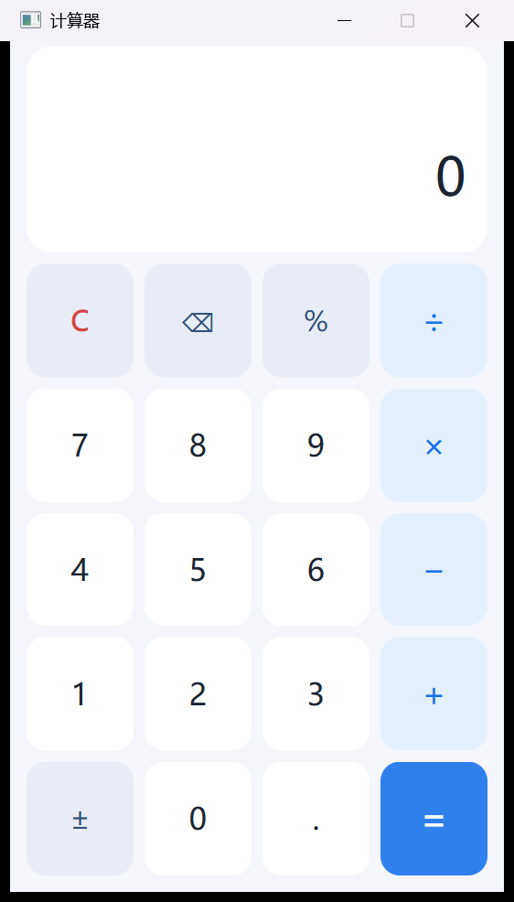

# 带键盘事件的计算器（Qt Widgets）

《Qt 应用程序开发》实验一：使用 Qt Widgets 实现一个支持鼠标与键盘操作的四则运算计算器。



## 功能

- 四则运算（+ − × ÷），支持小数与连续运算
- 退格、清除、正负号、百分号
- 表达式提示行：显示当前算式（如 `12.5 + 3 =`）
- 键盘输入与鼠标输入完全等价，共用同一套动作处理逻辑
- 异常输入处理：连续小数点、连续运算符、除数为 0、结果后继续输入、清除后重算

## 键盘映射

| 按键 | 功能 | 按键 | 功能 |
| --- | --- | --- | --- |
| `0`–`9` / 小键盘数字 | 数字 | `+` | 加 |
| `.` | 小数点 | `-` | 减 |
| `*` | 乘 | `/` | 除 |
| `Enter` / `=` | 等号 | `Backspace` | 退格 |
| `Esc` / `Delete` | 清除 | `%` | 百分号 |
| `F9` | 正负号 | | |

## 目录结构

```
Calculator/
├── main.cpp            程序入口
├── calculator.h/.cpp   主窗口：界面展示 + 输入事件分发
├── calculator.ui       Qt Designer 界面文件（显示区 + 5×4 按键网格）
├── calculatorlogic.h/.cpp  计算逻辑状态机（不依赖界面，可单独测试）
├── style.qss           界面样式表
├── resources.qrc       资源文件
└── tests/
    ├── tst_calculatorlogic.*   逻辑层单元测试（29 个用例）
    └── tst_calculatorwidget.*  界面集成测试（鼠标/键盘结果一致性）
```

设计上把“输入事件”和“计算规则”分开：

- `Calculator` 把鼠标点击和键盘按键都翻译成 `Action` 枚举，再交给唯一的 `applyAction()`；
- `CalculatorLogic` 只接收语义动作（输入数字、输入运算符……），维护操作数、运算符、错误状态等。

## 构建

使用 Qt 6.5 及以上版本，qmake + MinGW：

```bash
cd Calculator
mkdir build && cd build
qmake ../Calculator.pro
mingw32-make            # 或 make
./release/Calculator
```

## 运行测试

```bash
cd tests
mkdir -p build_logic && cd build_logic
qmake ../tst_calculatorlogic.pro && mingw32-make
./release/tst_calculatorlogic

cd ../
mkdir -p build_widget && cd build_widget
qmake ../tst_calculatorwidget.pro && mingw32-make
./release/tst_calculatorwidget
```
